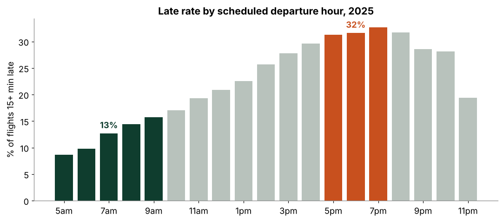
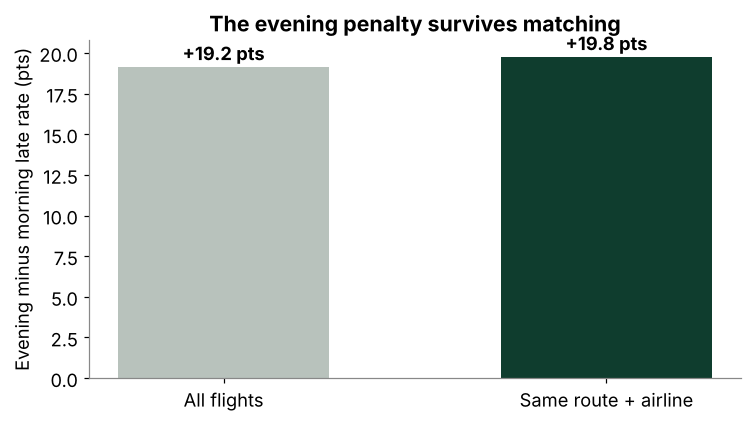
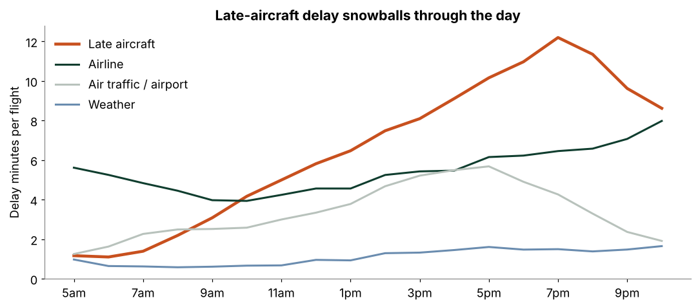
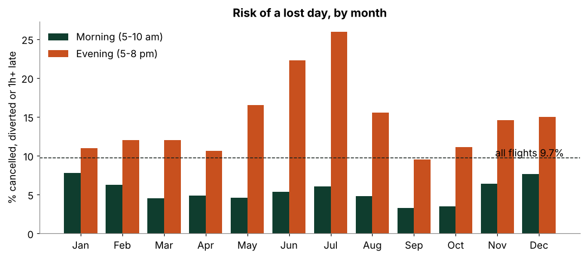
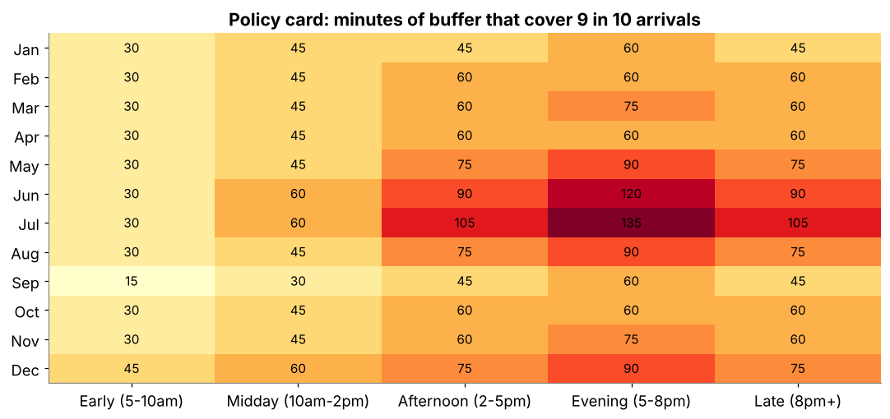
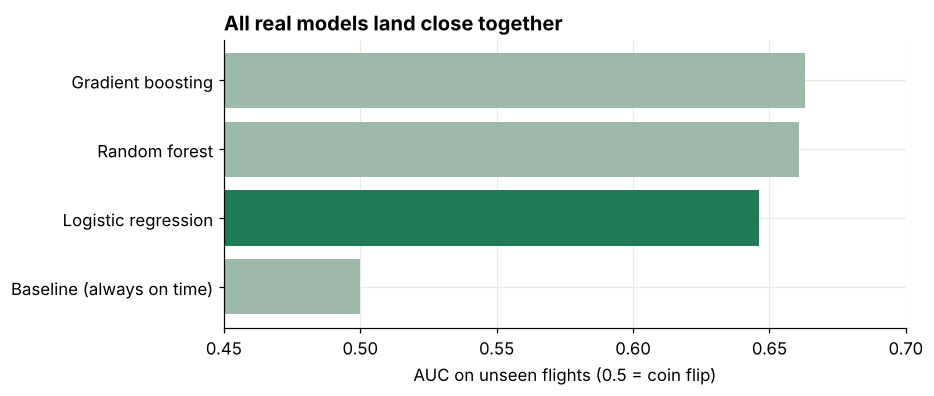
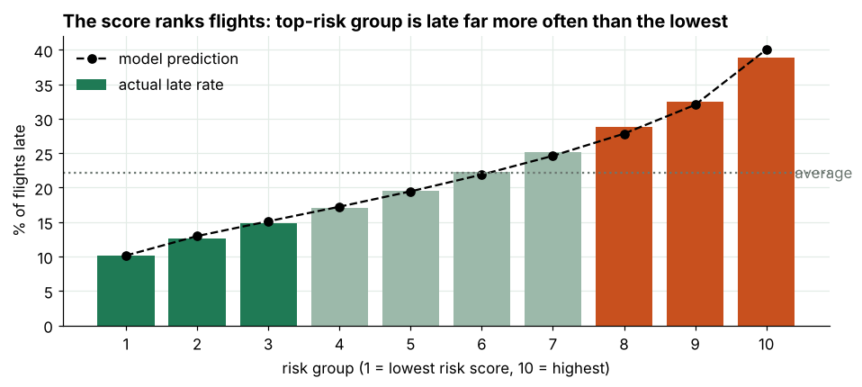

# When You Fly Matters More Than Who You Fly With: A Flight-Delay Playbook (2025)

*Questrom Chart Champ Datathon · Team A10 · Boston University MSBA*

* * *

## Background & Overview

[#background--overview](#background--overview)

Companies spend heavily on business travel, but travel policy is usually written around price and loyalty, not around **when** flights actually go wrong. A late flight costs the traveler hours, and a cancelled one can cost the whole day.

The datathon brief asked for 2 to 4 defensible changes to a company's travel policy. This project tests candidate rules against **kill tests written down before running the numbers**. A rule that fails its test gets dropped, and the rules that survive become the playbook.

**The analysis covers:**

- How big is the delay problem, and when does it happen?
- Is the evening penalty really about the hour, or just worse routes and airlines?
- When is a lost day likely enough to justify flying in the night before?
- How much buffer time covers 9 in 10 delays?
- Do "reliable" airlines stay reliable, and who ranks best on equal terms?
- Do any of ten other factors (region, hub size, weather, season...) change the rules?
- Can a machine-learning model add anything on top of simple rules?

**Scope:** every flight in the 2025 BTS on-time data from 10 carriers: **6,398,056 flights**.

* * *

## Data Structure Overview

[#data-structure-overview](#data-structure-overview)

| Source | Provider | Used for |
|--------|----------|----------|
| BTS Reporting Carrier On-Time Performance, 2025 (all flights, 12 monthly files) | U.S. Bureau of Transportation Statistics, via the datathon | All rules, costs, buffer card, airline ranking |
| 200,000-flight uniform random sample of the same data (with `sample_weight`) | Datathon student package | Training the ML check |

**Carriers:** AA, AS, B6, DL, MQ, OH, OO, UA, WN, YX (major and regional operators).

**Definitions used everywhere**

| Term | Meaning |
|------|---------|
| **Late** | Arrived 15+ minutes after schedule, among flights that flew |
| **Disrupted** | Late, cancelled or diverted |
| **Lost day** | Cancelled, diverted, or arrived 1+ hour late |
| **Morning / Evening** | Scheduled departure 5 to 10 am / 5 to 8 pm |
| **Cost per flight** | Lost hours × $60/hour. Late flights count their delay (capped at 3 hours), cancellations count 4 hours |

Column descriptions are in [`data/student_sample_200k/data_dictionary.csv`](data/student_sample_200k/data_dictionary.csv).

* * *

## Executive Summary

[#executive-summary](#executive-summary)

**Picking the departure hour does more for on-time performance than any other lever a traveler controls. Evening flights are far worse than morning ones, even on the same route with the same airline.**

| **23.6%** | **2.2x** | **97%** |
|:----------|:---------|:--------|
| of 2025 flights were late, cancelled or diverted | evening vs morning odds of losing the day (May to Jul: 21.6% vs 5.3%) | of 3,918 route+airline pairs have a worse evening than morning |

[](images/late_rate_by_hour.png)

*Late rate by scheduled departure hour, all of 2025. Green = before 10 am, orange = 5 pm or later.*

* * *

## Insights Deep Dive

[#insights-deep-dive](#insights-deep-dive)

### 1. The evening penalty is real, not a route-mix illusion

Evening flights could look worse simply because they fly worse routes or airlines. To test that, we compared morning vs evening **inside the same route and airline** (for example, one airline's BOS to ATL at 7 am vs 6 pm) and averaged across all 3,918 pairs with 30+ flights in both bands.

- The raw gap is **19.2 points**. Matched on route and airline it is **19.8 points**, so it does not shrink.
- Evening is worse in **3,795 of 3,918 pairs (96.9%)**. Ties count against us.
- Why: delays snowball. Late-incoming aircraft delay is the fastest-growing cause through the day, and a plane's first flight is late 14% of the time versus 31% for its fifth or later.

[](images/matched_gap.png)

[](images/late_aircraft_snowball.png)

### 2. When is it worth flying in the night before?

A **lost day** is the outcome that actually hurts: cancelled, diverted, or 1+ hour late.

- May to Jul: **21.6% of evening flights lose the day vs 5.3% of morning flights** (9.7% across all flights). About 1 in 5 evenings.
- Break-even rule: a night-before hotel pays for itself when the trip is worth more than **hotel cost ÷ 0.216**. At an assumed $200 hotel, that is about **$900**.
- On storm days the gap widens: 13.8% of morning flights lose the day vs 36.2% of evening flights.

[](images/lost_day_by_month.png)

### 3. A buffer card that covers 9 in 10 delays

For every month and time band we took the **90th percentile of arrival delay**: the cushion that covers 9 in 10 arrivals. It was built from days 1 to 15 of each month and tested on days 16 to 31, where it covered **90.4%** of flights.

[](images/buffer_card.png)

### 4. Who to fly with: equal-terms airline ranking

Raw airline rankings are skewed because airlines fly different routes at different times. We ran a regression with route fixed effects, departure-hour bands and month controls (route-clustered standard errors) in [`scripts/airline_adjusted.py`](scripts/airline_adjusted.py).

| Airline | Adjusted disrupted rate |
|:--------|:------------------------|
| United | 19.7% |
| Delta | 22.5% |
| JetBlue | 25.5% |
| American | 25.7% |
| Southwest | 25.8% |
| Alaska | 28.8% |
| PSA (regional) | 28.9% |

Delta looks best on raw numbers (20.9% vs United's 22.3%) because it flies easier routes and times. Equalized, United comes out first. The script also reports the regional operators (MQ, YX, OO, OH).

### 5. Everything else we checked

We scanned 10 factors and weather. Hour of day moves the late rate more than any of them, and the evening penalty is at least **2.3x** in every group of every factor.

- Region and hub size move lateness only 4 to 5 points.
- Weather is **6.5% of delay minutes but 62% of cancellations**, concentrated in a few storm days.

[](images/factor_scan.png)

#### Does machine learning add anything?

We trained a logistic regression, random forest and gradient boosting model on the 200,000-flight sample and tested on **6,088,351 unseen flights**. A coin flip scores 0.50 AUC.

| Model | AUC |
|:------|:----|
| Logistic regression | 0.65 |
| Random forest | 0.66 |
| Gradient boosting | 0.66 |

The fancier models add about 0.02. The model mostly rediscovers the hour effect, so simple rules lose almost nothing and are easier to explain. At a 50% cutoff it catches under 1% of late flights, so it ranks risk but is not an alarm.

[](images/ml_model_comparison.png)

[](images/ml_risk_groups.png)

* * *

## Recommendations

[#recommendations](#recommendations)

*These are suggestions backed by associations in the data, not proof of cause.*

**For travel managers (policy):**

1. **Fly early.** Default to flights before 10 am when there is a choice.
2. **Fly in the night before** when the trip is worth more than hotel ÷ 0.216 (about $900 at $200/night), especially May to Jul and during storm watches.
3. **Use the buffer card.** Book connections and meetings with the month and time-band cushion that covers 9 in 10 arrivals.
4. **Prioritize the top airlines when booking** (United, Delta, JetBlue on equal terms) and avoid Alaska and PSA-operated flights.

**For a pilot:** track missed-meeting and lost-day rates for travelers following the rules vs not. The pass/fail bar for a pilot still needs to be set by the team.

* * *

## Caveats & Assumptions

[#caveats--assumptions](#caveats--assumptions)

- **One year.** All results are 2025. The ML test is a held-out check within 2025, not a forecast of future years.
- **Assumed values.** $60/hour, 4 hours per cancellation, the 3-hour cap and the $200 hotel are assumptions, not data. The ranking holds from $30 to $150/hour; dollar totals scale with it.
- **Lost-day cutoff.** We use 1 hour. The evening/morning ratio is 2.2x at 1 and 2 hours and 1.85x at 15 minutes.
- **Association, not causation.** Matching on route and airline removes route mix, not every possible confounder.
- **Airline ranking.** It comes from a regression (not machine learning). We did not run a direct United-vs-Delta significance test.
- **Not modeled:** missed connections, meeting value, price, and passenger behavior if many travelers shift to mornings.

* * *

## Repository

[#repository](#repository)

| File | What it is |
|:-----|:-----------|
| [`flight_delay_kill_tests.ipynb`](flight_delay_kill_tests.ipynb) | The analysis: each rule, its kill test, costs, buffer card, factor scan, weather |
| [`flight_delay_ml_check.ipynb`](flight_delay_ml_check.ipynb) | The ML check: models, AUC, risk groups, what-if |
| [`scripts/airline_adjusted.py`](scripts/airline_adjusted.py) | Airline ranking regression on equal terms |
| [`data/`](data/) | Full 2025 data (12 monthly `.csv.gz` files) and the 200,000-flight sample |
| [`images/`](images/) | Charts used in this README |
| [`requirements.txt`](requirements.txt) | Python packages |

**To run it:**

```bash
pip install -r requirements.txt
jupyter notebook          # open a notebook from the repo root and Run All
python scripts/airline_adjusted.py   # optional: airline ranking, writes results/
```

Run from the repo root so the relative `data/` paths work. The full data is 6.4M rows, so give it a few GB of memory. The notebooks are saved with their outputs, so they render on GitHub without running.

* * *

## Team

[#team](#team)

Team A10, Boston University MSBA · Questrom Chart Champ Datathon, Fall 2026.
