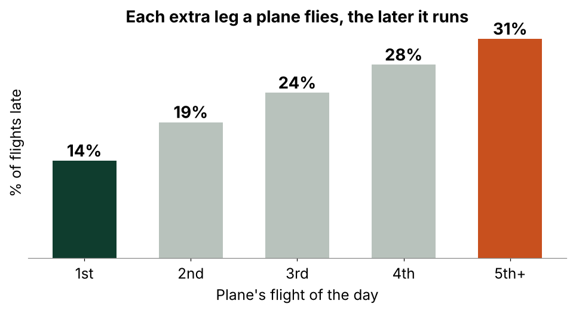
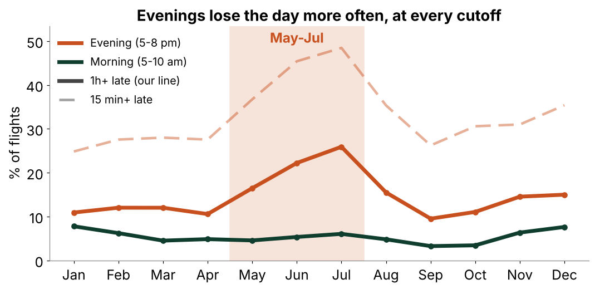
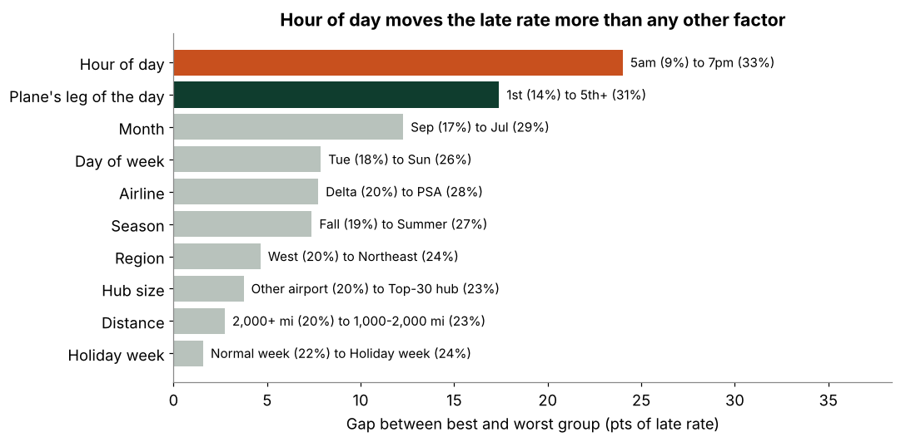
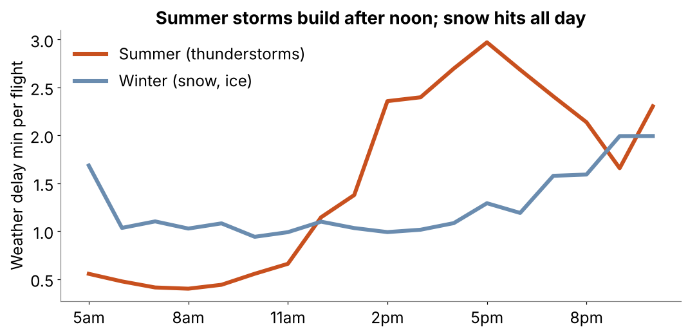
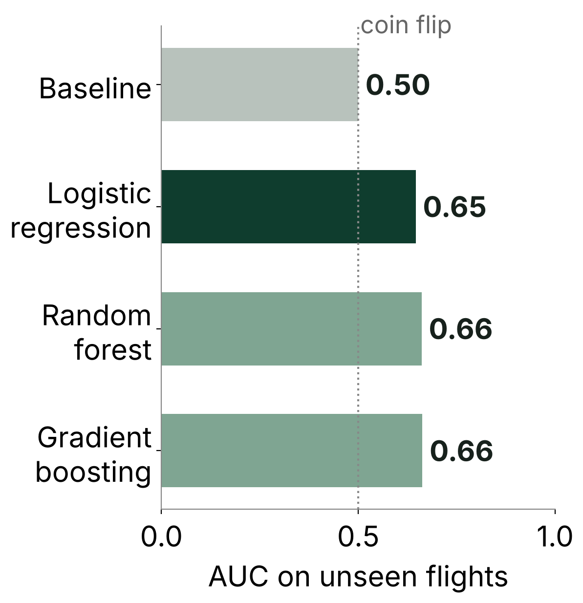
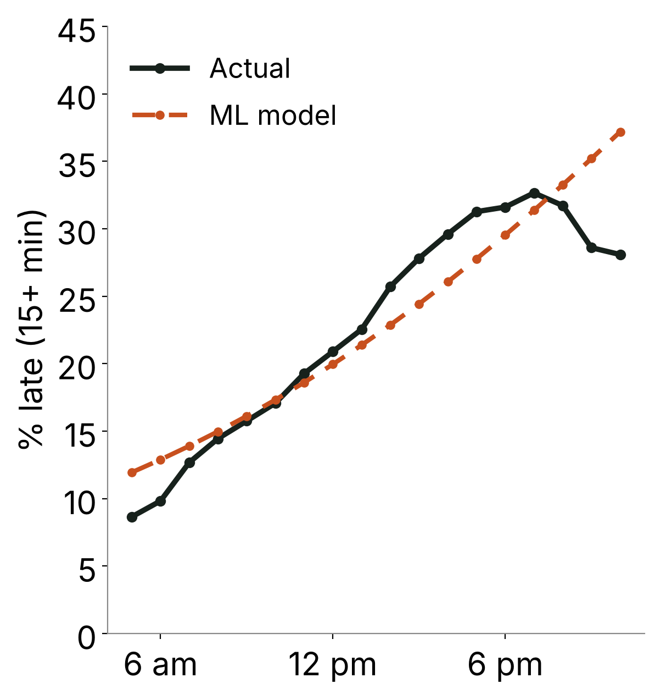
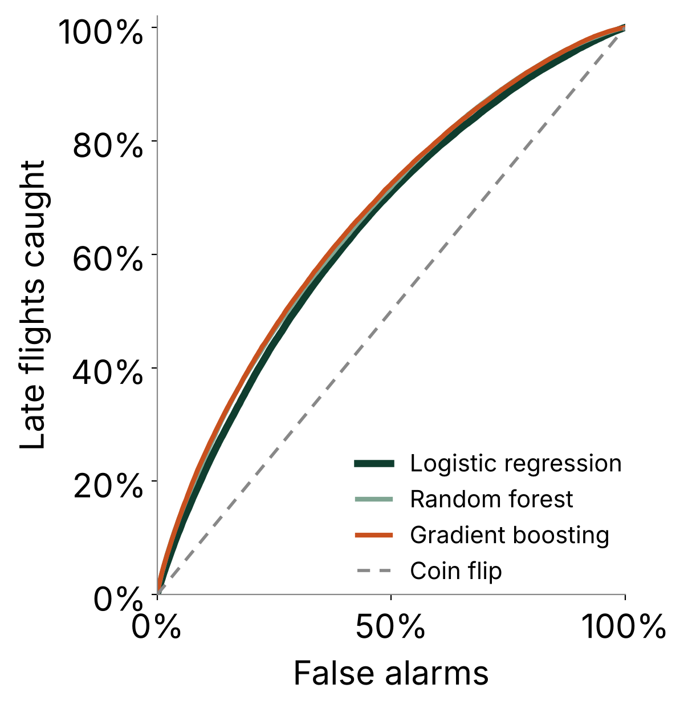

# Fly Early, Miss Fewer Meetings: A Flight-Delay Playbook

*Team A10 · Boston University MSBA · Questrom Chart Champ Datathon · all 6.4 million US flights in 2025*

[Background](#background--overview) · [Summary](#executive-summary) · [Insights](#insights-deep-dive) · [Recommendations](#recommendations) · [Caveats](#caveats--assumptions) · [Repository](#repository)

* * *

## Background & Overview

A company flies people to client meetings. When a flight is late, cancelled or diverted, that is a missed client, a lost workday or a surprise hotel bill. Yet most corporate travel policies say nothing about **when** to fly.

**The business problem:** can a company miss fewer meetings by changing its booking defaults, without spending more on travel?

**What we did:** we wrote down four candidate booking rules, set a test for each that was designed to kill it, and ran those tests on every flight in the 2025 BTS on-time data (**6,398,056 flights**). Rules that failed would have been dropped. All four survived.

**Definitions used throughout**

| Term | Meaning |
|------|---------|
| **Late** | Arrived 15+ minutes after schedule, among flights that flew |
| **Disrupted** | Late, cancelled or diverted |
| **Lost day** | Cancelled, diverted, or arrived 1+ hour late |
| **Morning / Evening** | Scheduled departure 5 to 10 am / 5 to 8 pm |
| **Cost per flight** | Hours lost × $60 an hour. Late flights count their delay (capped at 3 hours), cancellations count 4 hours |

* * *

## Executive Summary

**When you fly matters more than anything else a traveler controls. Evening flights are far worse than morning ones, even on the same route with the same airline.**

| **23.5%** | **97%** | **2.2x** |
|:----------|:--------|:---------|
| of 2025 flights were late, cancelled or diverted | of same-route, same-airline comparisons were worse in the evening | more likely to lose the day on a May to July evening flight (21.6%) than a morning one (5.3%) |

**The four rules and how each one was tested**

| Rule | Test it had to pass | Result |
|------|---------------------|--------|
| 1. Fly early | Does the morning advantage survive on the same route and airline? | Yes: evening worse in 97% of 3,918 route+airline pairs |
| 2. Fly in the night before for must-attend events | Is a lost day at least 1.5x the yearly average on risky flights? | Yes: 21.6% vs 9.7% |
| 3. Add the right buffer | Set on days 1 to 15, do 87 to 93% of arrivals land inside it on days 16 to 31? | Yes: 90.4% |
| 4. Prefer the most reliable airlines | Does the best airline on a route in Jan to Jun stay best in Jul to Dec? | Yes: 77% of 793 routes (a coin flip is 50%) |

**What it is worth:** moving 1,000 trips from evening to morning saves about **$14K of traveler time** (at an assumed $60/hour) and about **200 late arrivals**, at no software cost.

* * *

## Insights Deep Dive

Each chart below comes straight from the notebooks. For each one: what you are looking at, what it shows, and why it matters.

### 1. The problem is lateness, not cancellations

- **23.5% of flights were disrupted, but only 1.5% were cancelled.** The rest is lateness, so lateness is the problem to solve.
- **$17 per flight** is the *average* cost of lost traveler time across all flights, valuing an hour at $60. Most flights cost $0. A flight 3 hours late costs $180 and a cancellation $240, and averaging those over every flight gives about $17.

### 2. Delay risk climbs all day

[](images/1_late_rate_by_hour.png)

- **What you are looking at:** each bar is the share of flights that landed 15+ minutes late, by the hour they were scheduled to leave. Green bars are before 10 am, orange are 5 pm or later.
- **What it shows:** early flights are late about 9 to 13% of the time. By the early evening it is about one in three. Morning flights (5 to 10 am) are late 12.6% of the time, evening flights (5 to 8 pm) 31.8%.
- **Why it matters:** the airlines and network are the same all day. Only the hour changes. That is the lever a traveler can actually pull.

### 3. It is the hour, not the route, and delays snowball

[](images/2_matched_gap.png)

- **The objection:** evening flights might just be on worse routes or airlines.
- **The test:** we compared the *same airline on the same route* at different times (for example one airline's Boston to Atlanta flight at 7 am vs 6 pm) across 3,918 such pairs with 30+ flights in both bands.
- **What it shows:** the evening-minus-morning gap is 19.2 points across all flights and **19.8 points when matched**. It does not shrink, and evening is worse in 3,795 of 3,918 pairs (97%). Ties counted against us.

[](images/3_leg_of_day.png)

- **Why the hour matters:** each plane flies several legs a day, and a delay rides into every later leg. A plane's first flight of the day is late 14% of the time, its fifth or later 31%. Of flights that leave 15+ minutes late, 81% still land 15+ minutes late. Planes rarely catch up (the median late-departing flight makes up only 7 minutes).

### 4. When is it worth flying in the night before?

[](images/4_lost_day_by_month.png)

- **What you are looking at:** the share of flights that lose the day (cancelled, diverted or 1+ hour late), by month. The solid orange line is evening flights, the solid dark line is morning flights. The faded dashed line shows evening flights on a looser 15-minute cutoff, for comparison.
- **What it shows:** evenings are above mornings in every month and at every cutoff. In May to July, **21.6% of evening flights lose the day vs 5.3% of morning flights** (9.7% across all flights): about 1 in 5.
- **The break-even rule:** a night-before hotel pays off when the meeting is worth more than **hotel cost ÷ 0.216**. At an assumed $200 hotel, that is about **$900**. The company sets the meeting value.

### 5. The buffer card: how much cushion covers 9 in 10 delays

[](images/5_buffer_card.png)

- **How to read it:** find the month on the left and the departure time on the bottom. The number is the minutes of buffer that would have covered 9 out of 10 arrivals.
- **How it was built:** no model. For each month and time of day, it is the delay that 90% of past flights stayed under (the 90th percentile), for flights that flew.
- **What it shows:** early mornings need only 15 to 45 minutes. July evenings need 135.
- **Does it hold up?** We built it from days 1 to 15 of each month and checked it on days 16 to 31, which it was not built from. It covered **90.4%** of arrivals.

### 6. Who to fly with

Raw airline rankings reward airlines that fly easier routes. So we ranked them on equal terms: what each airline's disruption rate would be if all flew the same routes, at the same hours, in the same months (a regression in [`scripts/airline_adjusted.py`](scripts/airline_adjusted.py)).

| Airline | Disrupted flights (adjusted) |
|:--------|:-----------------------------|
| United | 19.7% |
| Delta | 22.5% |
| JetBlue | 25.5% |
| American / Southwest | 25.7% / 25.8% (close to a tie with JetBlue) |
| Alaska | 28.8% |
| PSA (operates regional flights) | 28.9% |

- **What it shows:** Delta is first on raw numbers (20.9% vs United's 22.3%), but on equal terms United moves to the top.
- **Limits:** regional airlines (Envoy, Republic, SkyWest) are left off because travelers book the major brand they fly for. Fares are not in the data, so a company should weigh any fare gap against the disruption cost.

### 7. We checked everything else: only the hour wins

[](images/6_factor_scan.png)

- **What you are looking at:** for each factor, the gap between its best and worst group's late rate. A longer bar means that factor moves lateness more.
- **What it shows:** hour of day (late 9% at 5 am vs 33% at 7 pm) moves the late rate more than any other factor. Region and hub size move it only 4 to 5 points, and the evening is at least 2.3x worse in every group of every factor.

[](images/7_weather_by_hour.png)

- **Weather causes cancellations more than delays:** 6.5% of delay minutes but 62% of cancellations, and a few storm days do most of the damage (59% of weather cancellations came on 8% of region-days).
- **What the chart shows:** summer thunderstorms build after noon and peak late afternoon, while winter snow hits all day. That is why Rule 2 (fly in the night before) covers winter and storm-watch days. Even on storm days, morning flights lost the day 13.8% of the time vs 36.2% in the evening.

### 8. Why we did not use machine learning

We tried it. Three models (logistic regression, random forest, gradient boosting) plus a do-nothing baseline were trained on a 200,000-flight sample and tested on the other **6.1 million flights they never saw**, using hour, month, weekday, airline and distance.

[](images/8_ml_models.png)

- **How to read it:** a score of 0.50 is a coin flip. 0.65 means if you pick one late and one on-time flight, the model ranks the late one as riskier about 2 times in 3.
- **What it shows:** all three beat a coin flip, but the fancy models add only about 0.02 over the simple one.

[](images/9_ml_by_hour.png)

- **What it shows:** the model rediscovers Rule 1, with risk climbing through the day. It misses the dip after 8 pm, which is one reason we trust the actual counts over a model.

[](images/10_ml_roc.png)

- **How to read it:** the further a curve bows up and left from the diagonal coin-flip line, the better the model. Here the three curves almost overlap.
- **Takeaway:** simple rules lose almost nothing against ML and are easy to explain to a travel manager. All testing is within 2025, so this is not a forecast of future years.

* * *

## Recommendations

*Suggestions backed by patterns in the data, not proof of cause. All four are defaults, never bans.*

1. **Fly early.** Default to departures before 10 am for anything with a fixed start time.
2. **Night before.** For must-attend events in May to July, in winter, or when a storm warning is out, fly in the day before.
3. **Size the buffer.** Use 30 to 45 minutes after a morning flight and 75 to 135 minutes after an evening one, most in summer.
4. **Prefer the proven airline.** Prioritize United, Delta and JetBlue when booking, and avoid Alaska and PSA-operated flights.

**How you would know it works:** track one number, *disruption cost per trip* (lost hours × value of an hour), priced from the company's own bookings. Switch half the departments to the rules first, compare the two halves over three months, then roll out to everyone if the gap is real.

* * *

## Caveats & Assumptions

- **One year of data.** All results are 2025. The ML test is a held-out check within 2025, not a forecast.
- **Assumed values.** $60 an hour, 4 hours per cancellation, the 3-hour cap and the $200 hotel are assumptions, not data. Dollar totals scale with them (the ranking of hours holds from $30 to $150 an hour).
- **Lost-day cutoff.** We use 1 hour. The evening/morning ratio is 2.2x at 1 and at 2 hours and 1.85x at 15 minutes.
- **Association, not causation.** Matching on route and airline removes route mix, not every possible confounder.
- **Airline ranking** comes from a regression (not machine learning), and we did not run a direct United vs Delta significance test.
- **Not in the data:** fares, missed connections, the value of a meeting, and what happens if many travelers move to mornings.

* * *

## Repository

| File | What it is |
|:-----|:-----------|
| [`flight_delay_kill_tests.ipynb`](flight_delay_kill_tests.ipynb) | The analysis: each rule, its test, costs, buffer card, other factors, weather |
| [`flight_delay_ml_check.ipynb`](flight_delay_ml_check.ipynb) | The machine-learning check |
| [`scripts/airline_adjusted.py`](scripts/airline_adjusted.py) | Airline ranking on equal terms |
| [`data/`](data/) | 2025 BTS flight data: 12 monthly CSVs, plus the 200,000-flight sample |
| [`images/`](images/) | Charts used in this README |

**To run it:**

```bash
pip install -r requirements.txt
jupyter notebook                      # open a notebook from the repo root, then Run All
python scripts/airline_adjusted.py    # optional: airline ranking
```

Run from the repo root so the `data/` paths work. The full data is 6.4 million rows, so give it a few GB of memory. The notebooks are saved with their outputs, so they show on GitHub without running. Source: BTS Reporting Carrier On-Time Performance, 2025, via the datathon.

* * *

## Team

Team A10 · Boston University MSBA · Questrom Chart Champ Datathon, Fall 2026
